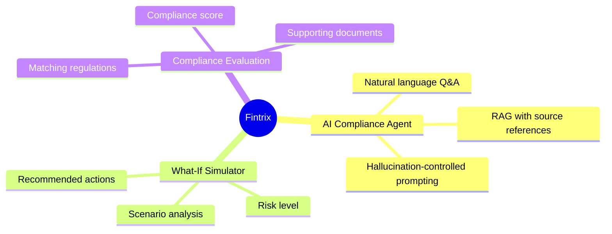
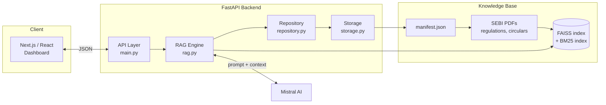
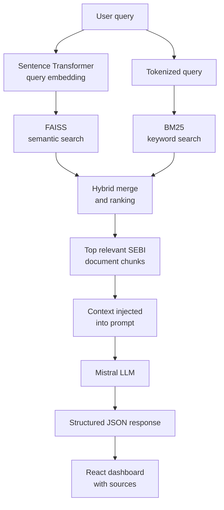
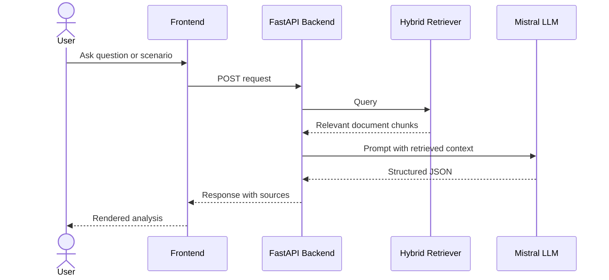
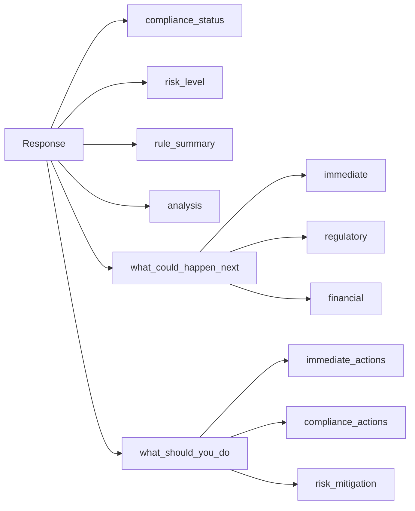
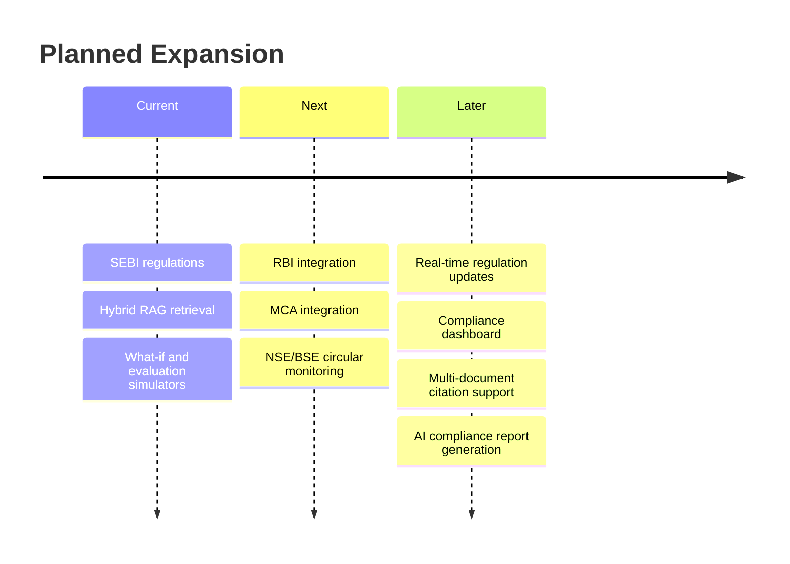

# Fintrix

**AI Financial Compliance Assistant for Indian securities regulation.**

Fintrix is an AI-powered compliance platform that helps users understand Indian financial regulations through Retrieval-Augmented Generation (RAG), scenario analysis, and compliance evaluation.

Built for hackathons, it combines semantic search over official regulatory documents with Large Language Models to deliver explainable, regulation-backed responses.

---

## Table of Contents

- [Features](#features)
- [System Architecture](#system-architecture)
- [Retrieval Pipeline](#retrieval-pipeline)
- [Request Flow](#request-flow)
- [Tech Stack](#tech-stack)
- [Project Structure](#project-structure)
- [Installation](#installation)
- [Example Response](#example-response)
- [Data Sources](#data-sources)
- [Future Scope](#future-scope)
- [Team](#team)
- [License](#license)

---

## Features



### AI Compliance Agent

- Ask natural language questions about SEBI regulations
- Answers generated using Retrieval-Augmented Generation (RAG)
- Relevant sections retrieved from official regulatory documents
- Grounded responses with source references
- Hallucination-controlled prompting

Example questions:

- What are the disclosure requirements for insider trading?
- Explain Unpublished Price Sensitive Information (UPSI).
- What are the responsibilities of a compliance officer?

### What-If Simulator

Analyze financial scenarios before taking action.

> What if I buy company shares before quarterly earnings are announced?

Fintrix evaluates:

| Output | Description |
|---|---|
| Compliance Status | Whether the scenario is compliant |
| Risk Level | Severity of the regulatory risk |
| Rule Summary | The rules that apply |
| Detailed Analysis | Reasoning behind the assessment |
| Possible Consequences | What could happen next |
| Recommended Actions | What the user should do |

### Compliance Evaluation Simulator

Evaluate financial activities against SEBI regulations. Returns:

- Matching regulations
- Compliance score
- Relevant rule summary
- Supporting regulatory documents

---

## System Architecture



---

## Retrieval Pipeline



**Step by step**

1. The user submits a question.
2. A query embedding is generated with Sentence Transformers.
3. Hybrid retrieval runs FAISS semantic search and BM25 keyword search.
4. The most relevant SEBI document chunks are retrieved.
5. The context is injected into the Mistral prompt.
6. A structured JSON response is generated.
7. The response is displayed alongside its sources.

---

## Request Flow



---

## Tech Stack

| Layer | Technologies |
|---|---|
| Frontend | Next.js, React, Tailwind CSS |
| Backend | FastAPI, Python |
| AI | Mistral AI, Sentence Transformers, FAISS, BM25, RAG pipeline |
| Data | Official SEBI regulatory documents, PDF knowledge base, manifest-based document indexing |

---

## Project Structure

```text
Fintrix/
├── Backend/
│   ├── app/
│   │   ├── main.py
│   │   ├── rag.py
│   │   ├── repository.py
│   │   ├── storage.py
│   │   └── ...
│   └── requirements.txt
│
├── Frontend/
│   └── fintrix-web/
│
├── sebi/
│   ├── manifest.json
│   ├── circulars/
│   ├── regulations/
│   └── ...
│
└── README.md
```

---

## Installation

### Clone

```bash
git clone <repository-url>
cd Fintrix
```

### Backend

```bash
cd Backend
python -m venv .venv
.venv\Scripts\activate
pip install -r requirements.txt
```

Create a `.env` file:

```env
MISTRAL_API_KEY=your_api_key_here
```

Run the server:

```bash
python -m uvicorn app.main:app --reload --port 8001
```

### Frontend

```bash
cd Frontend/fintrix-web
npm install
npm run dev
```

---

## Example Response

```json
{
  "compliance_status": "Non-Compliant",
  "risk_level": "High",
  "rule_summary": "...",
  "analysis": "...",
  "what_could_happen_next": {
    "immediate": [],
    "regulatory": [],
    "financial": []
  },
  "what_should_you_do": {
    "immediate_actions": [],
    "compliance_actions": [],
    "risk_mitigation": []
  }
}
```



---

## Data Sources

Fintrix retrieves information from official regulatory documents, including:

- SEBI Regulations
- SEBI Circulars
- SEBI Master Circulars
- Compliance Guidelines

---

## Future Scope



---

## Team

Built as a hackathon project to simplify financial compliance using Artificial Intelligence and Retrieval-Augmented Generation.

---

## License

This project is intended for educational and hackathon purposes.
